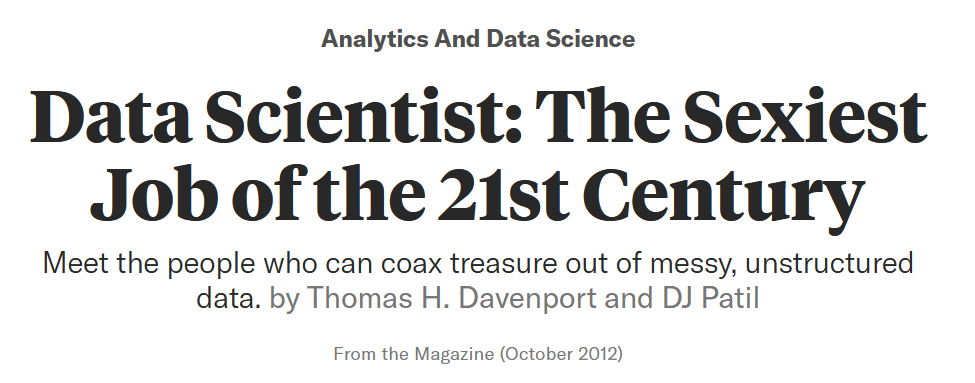
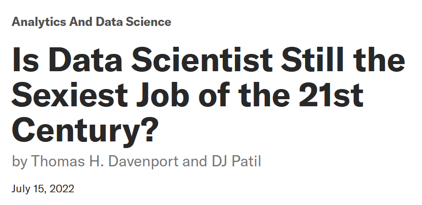
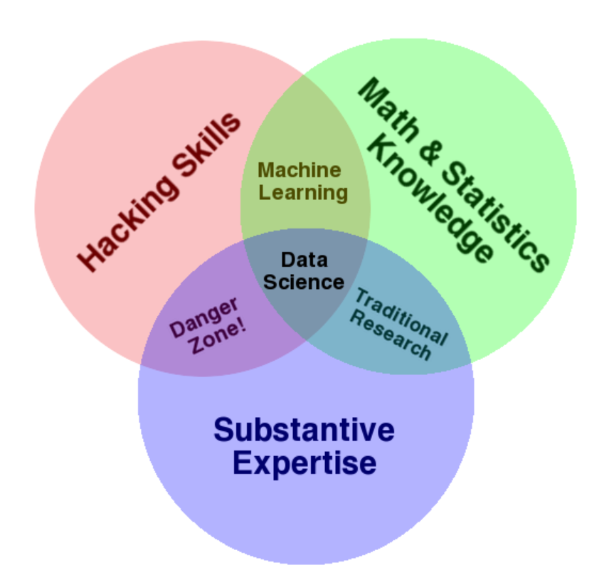
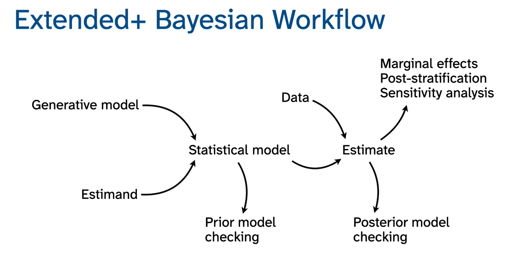
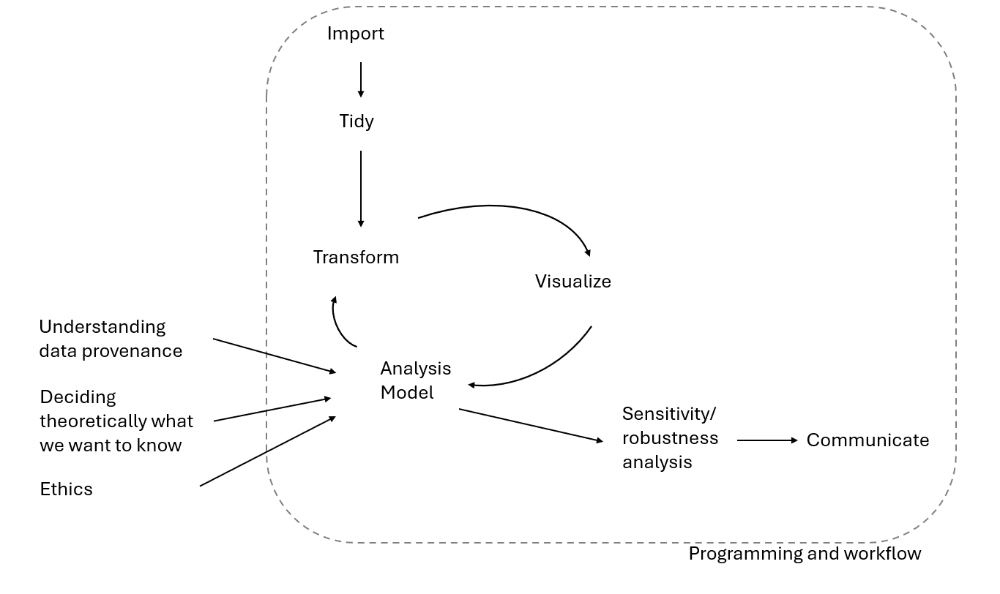
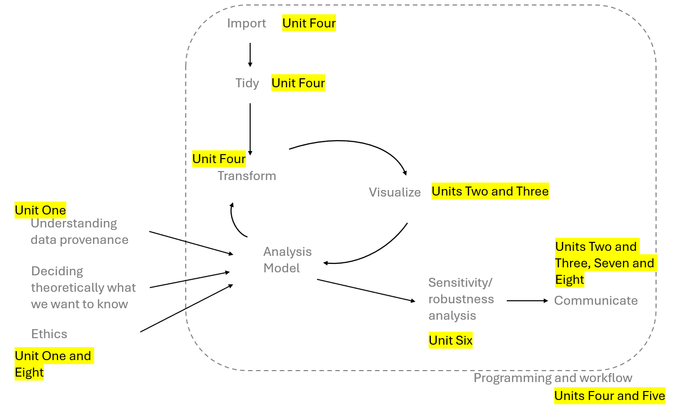

```{r}
#| include: false
options(digits = 2)
```

## Learning outcomes
- By the end of this session you will
  - Understand what Social Data Science is


## What is data science?


## What is data science?


## What is data science?


## What is data science?


## What is data science?
- A a mix of some coding, some data analysis and lots of substantive knowledge?
- A research workflow that workflow that facilitates the above?

## Workflows all the way down


## What's the difference
- The McElreath workflow starts with _thinking about how the data came about_ rather than importing the data into a software program
- I think this is key for _social_ data science: theorizing about data needs to be a key part of the workflow

## A proposal


## A proposal


## Social data science
- Theoretical skills in understanding what social data is, what it can tell us and what it can't
- Practical skills in 
  - data manipulation and workflow
  - data visualization and communication
  - assessing data limitations

## References