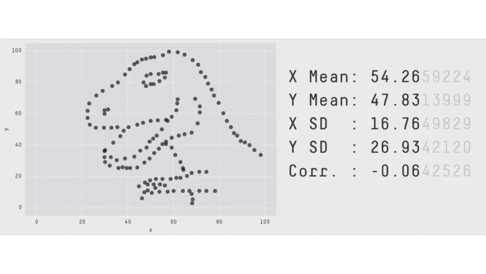
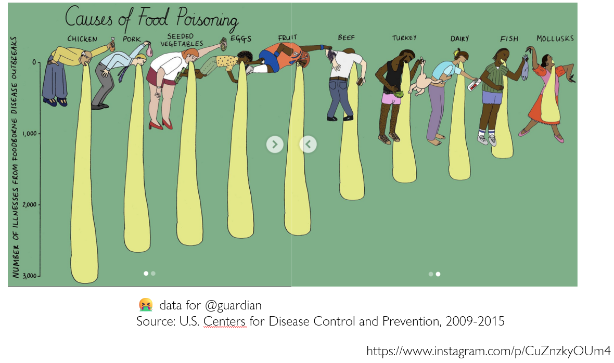
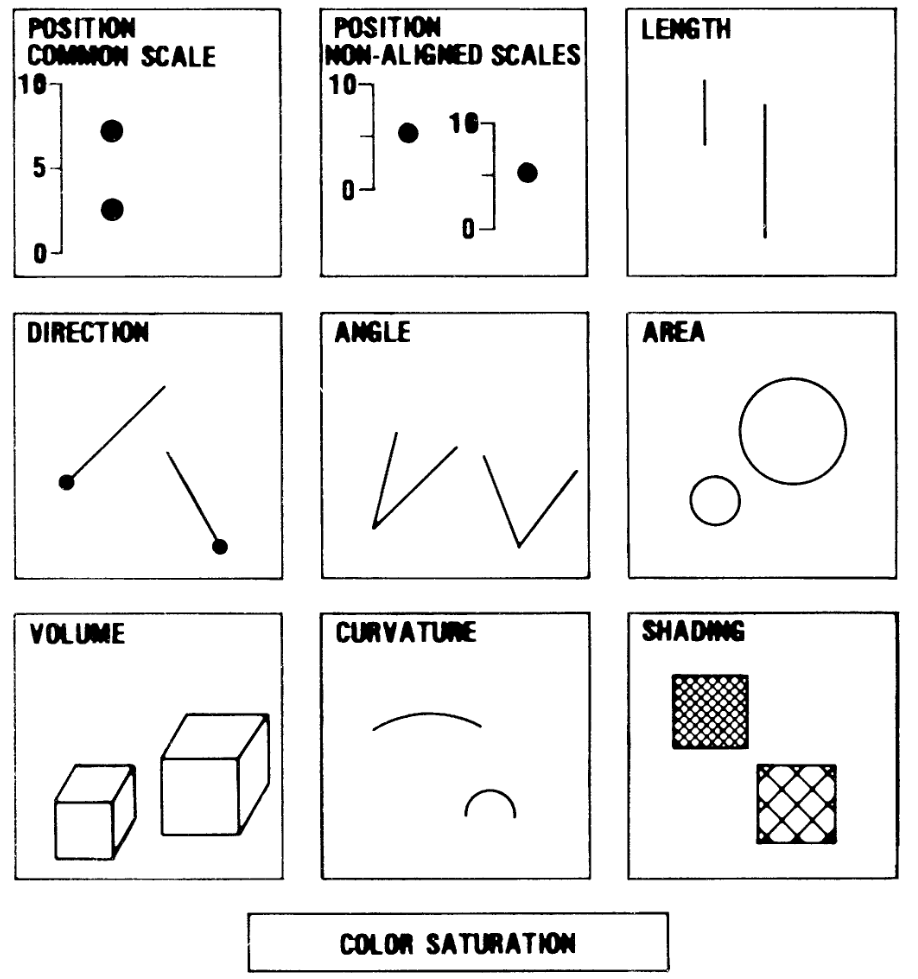
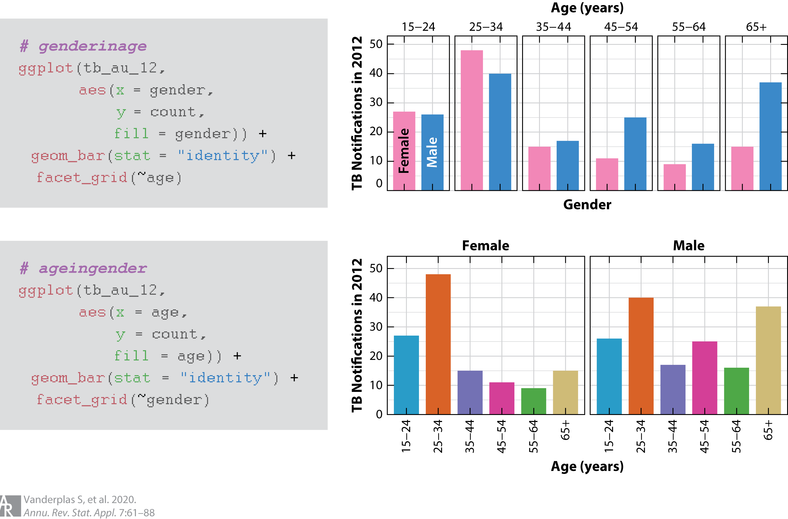

```{r}
#| include: false
options(digits = 2)
library(tidyverse)
```

## Learning outcomes

- Understand (some) basic principles of data visualization

## Overview
- Why plot?
- Infovis versus statistical graphics
- Three principles of data visualization


## Why plot in the first place?

> “Visualizations give you answers to questions you didn’t know you had” — 

Ben Shneiderman

## Why plot in the first place?

- It's a key part of any data analysis
- Relying on summary statistics can be misleading 



## Audience
- As with all communication, audience is key!
- Are you doing 'infovis' or statistical graphics?

:::{.aside}
@gelmanInfovisStatisticalGraphics2013
:::

## Infovis
- "grabbing the readers’ attention and telling them a story"
- "draw attention to [the] graphics and thus to the subject matter"

:::{.aside}
@gelmanInfovisStatisticalGraphics2013
:::

## Infovis


## Statistical graphics
- Interested in "what can be got out of the available data"
- "finding effective and precise ways of representing data, whether raw data, statistics, or model analyses"
- the "right compariso[n] is important [because] numbers on their own make little sense"
- Exact end result may differ based on whether you are producing 'presentation' graphics (a "small number of graphs, which may be viewed by thousands") or exploratory graphs ("thousands of graphs, which are viewed by one person, yourself")

:::{.aside}
@gelmanInfovisStatisticalGraphics2013
:::


## A statistical graphic

```{r}


food <- tribble(
  ~group, ~category, ~outbreaks, ~outbreak_pct, ~illnesses, ~illness_pct,

  "Aquatic animal", "Mollusks", 105, 8, 846, 3,
  "Aquatic animal", "Fish", 222, 17, 1353, 5,
"Land animal", "Dairy", 136, 11, 1639, 6,
  "Land animal", "Eggs", 36, 3, 2470, 9,
  "Land animal", "Beef", 106, 8, 1934, 7,
  "Land animal", "Pork", 89, 7, 2670, 10,
  "Land animal", "Chicken", 123, 10, 3114, 12,
  "Land animal", "Turkey", 50, 4, 1675, 6,
   "Plant", "Seeded vegetables", 44, 3, 2572, 10,
   "Plant", "Vegetable row crops", 81, 6, 1972, 7,
  "Plant", "Fruits", 78, 6, 2420, 9
)

food |> 
ggplot(aes(x = fct_reorder(category, -illnesses), y = illnesses)) +
geom_bar(stat = "identity") +
scale_x_discrete(labels = scales::label_wrap(10)) +
labs(y = "Number of illnessess from foodborne disease outbreaks",
x = "Food category",
caption = "Source: U.S. Centers for Disease Control and Prevention, 2009-2015")

```

# Principles of data visualization{background-color="#006938" style="color: white;"}

## Principles of data visualization

- How we read graphs
- Principles of chart design
- An example


## How we read graphs

:::: {.columns}

::: {.column width="50%"}

- Some visual comparisons are easier to make than others

__Easiest__

1. Position along a common scale
2. Position along identical, non-aligned scales
3. Length
4. Angle or slope
5. Area
6. Volume
7. Colour hue / saturation

__Hardest__


:::

::: {.column width="50%"}



:::

::::

## How we read graphs (2)

:::: {.columns}

::: {.column width="50%"}

- Proximity: "objects or shapes that are close to one another appear to form groups... place items to compare close together, and less important comparisons further apart"
    - ... so think about how your mapping of variables to aesthetics and facets highlights some comparisons and not others

:::

::: {.column width="50%"}



:::

::::

# Principles of chart design{background-color="#006938" style="color: white;"}


## Principles of chart design
- [Match perceptual and data topology](http://stat405.had.co.nz/lectures/20-effective-vis.pdf)
- Dual coding
- Colour accessibility

## Perceptual and data topology

- Some `aes`thetic mappings have implicit orders (like position and size), others are unordered (like shape)
   - If you’re using a graphical element to show relative size of quantities make larger size = larger quantity


## Perceptual and data topology

- From Hadley Wickham's [excellent slides on data-viz](http://stat405.had.co.nz/lectures/20-effective-vis.pdf):

```{r wickham-1, out.width='60%', fig.align='center'}
knitr::include_graphics("https://raw.githubusercontent.com/benmatthewsed/ui-data-visualization-course/master/figures/page-0.gif")
```


## Perceptual and data topology

- From Hadley Wickham's [excellent slides on data-viz](http://stat405.had.co.nz/lectures/20-effective-vis.pdf):

```{r wickham-2, out.width='60%', fig.align='center'}
knitr::include_graphics("https://raw.githubusercontent.com/benmatthewsed/ui-data-visualization-course/master/figures/page-1.gif")
```


## Perceptual and data topology

- From Hadley Wickham's [excellent slides on data-viz](http://stat405.had.co.nz/lectures/20-effective-vis.pdf):

```{r wickham-3, out.width='60%', fig.align='center'}
knitr::include_graphics("https://raw.githubusercontent.com/benmatthewsed/ui-data-visualization-course/master/figures/page-2.gif")
```


## Perceptual and data topology

- From Hadley Wickham's [excellent slides on data-viz](http://stat405.had.co.nz/lectures/20-effective-vis.pdf):

```{r wickham-4, out.width='60%', fig.align='center'}
knitr::include_graphics("https://raw.githubusercontent.com/benmatthewsed/ui-data-visualization-course/master/figures/page-3.gif")
```


## Perceptual and data topology

- From Hadley Wickham's [excellent slides on data-viz](http://stat405.had.co.nz/lectures/20-effective-vis.pdf):

```{r wickham-5, out.width='60%', fig.align='center'}
knitr::include_graphics("https://raw.githubusercontent.com/benmatthewsed/ui-data-visualization-course/master/figures/page-4.gif")
```


## Perceptual and data topology

- From Hadley Wickham's [excellent slides on data-viz](http://stat405.had.co.nz/lectures/20-effective-vis.pdf):

```{r wickham-6, out.width='60%', fig.align='center'}
knitr::include_graphics("https://raw.githubusercontent.com/benmatthewsed/ui-data-visualization-course/master/figures/page-5.gif")
```


## Perceptual and data topology

- From Hadley Wickham's [excellent slides on data-viz](http://stat405.had.co.nz/lectures/20-effective-vis.pdf):

```{r wickham-7, out.width='60%', fig.align='center'}
knitr::include_graphics("https://raw.githubusercontent.com/benmatthewsed/ui-data-visualization-course/master/figures/page-6.gif")
```


## Perceptual and data topology

- From Hadley Wickham's [excellent slides on data-viz](http://stat405.had.co.nz/lectures/20-effective-vis.pdf):

```{r wickham-8, out.width='60%', fig.align='center'}
knitr::include_graphics("https://raw.githubusercontent.com/benmatthewsed/ui-data-visualization-course/master/figures/page-7.gif")
```


## Dual coding

- You can encode the same variables to multiple aesthetic parameters (easily in `ggplot2`) to aid comprehension
- This can also aid accessibility by reducing reliance on e.g. colour to distinguish variables

:::: {.columns}

::: {.column width="50%"}

```{r dual_code, fig.show='hide'}

# code am to colour

ggplot(
  data = mtcars,
  mapping = aes(x = disp, y = drat)
) +
  geom_point(
    mapping = aes(colour = am)
  )

```

:::

::: {.column width="50%"}

```{r}
#| label: dual_code_display
#| echo: false
#| fig-retina: 1.25

ggplot(
  data = mtcars,
  mapping = aes(x = disp, y = drat)
) +
  geom_point(
    mapping = aes(colour = am)
  )
```

:::

::::


## Dual coding

- You can encode the same variables to multiple aesthetic parameters (easily in `ggplot2`) to aid comprehension
- This can also aid accessibility by reducing reliance on e.g. colour to distinguish variables

:::: {.columns}

::: {.column width="50%"}

```{r dual_code_2, fig.show='hide'}

# code am to shape as well
# note - I had to cheat here and
# ask ggplot2 to treat
# am as a factor variable

ggplot(
  data = mtcars,
  mapping = aes(x = disp, y = drat)
) +
  geom_point(
    mapping = aes(
      colour = am,
      shape = factor(am)
    )
  )

```

:::

::: {.column width="50%"}

```{r}
#| label: dual_code_2_display
#| echo: false
#| fig-retina: 1.25

ggplot(
  data = mtcars,
  mapping = aes(x = disp, y = drat)
) +
  geom_point(
    mapping = aes(
      colour = am,
      shape = factor(am)
    )
  )
```

:::

::::


## Colour accessibility

- You can use colour scales designed to have good perceptual properties for [different kinds of colour-blindness](https://serialmentor.com/dataviz/color-pitfalls.html#not-designing-for-color-vision-deficiency) (`ggplot2` defaults aren't so good for this)

# Wrap-up{background-color="#006938" style="color: white;"}

## Learning outcomes

- Understand (some) basic principles of data visualization

