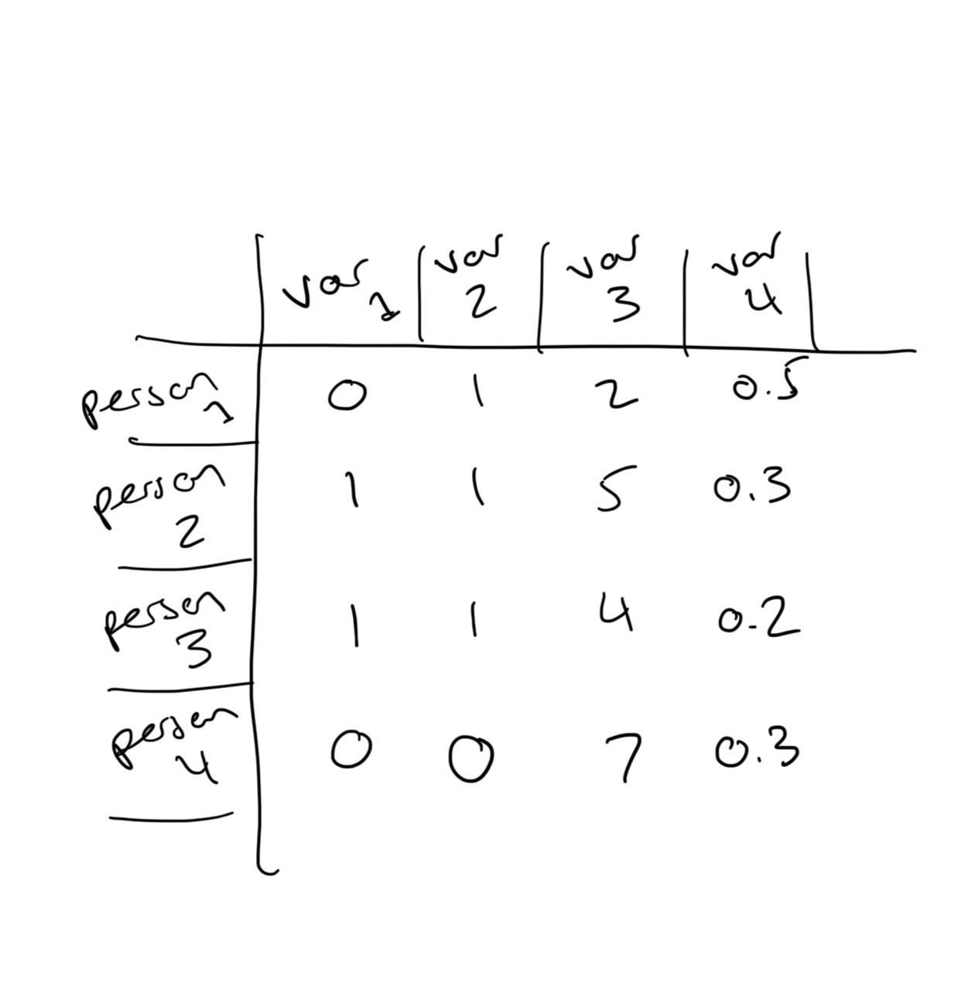
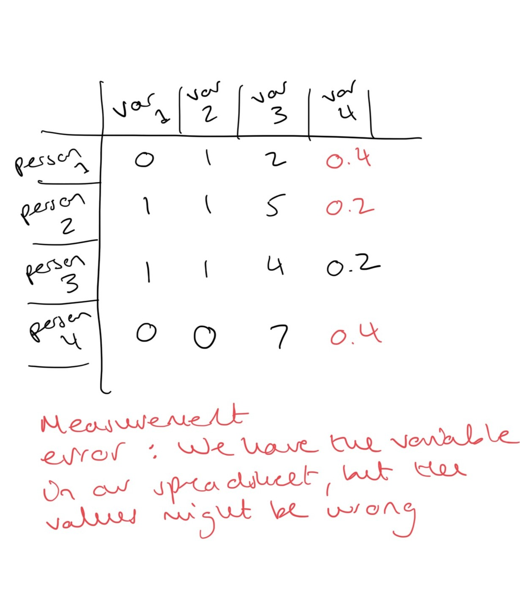
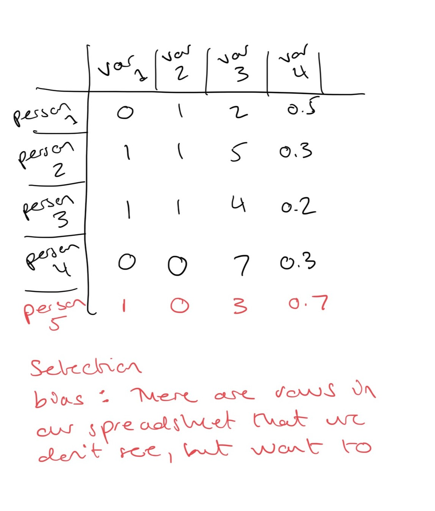
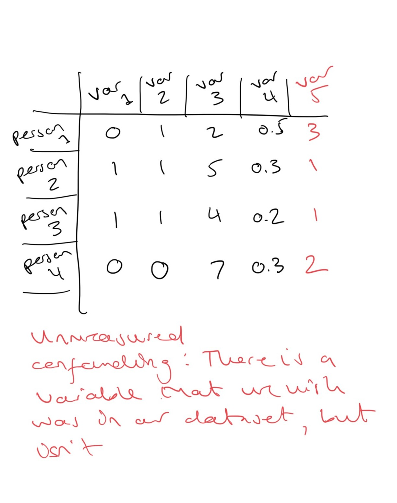

```{r}
#| include: false
options(digits = 2)
```

## Learning outcomes
- By the end of this session you will
  - Understand the challenges of data you don't have on analysing the data you do have

---

## Going from the small world to the large world

- A statistical model is only ever the map and never the territory
- The statistical models are 'small worlds' of their own - distinct from the 'large world' that we actually live in
- Our spreadsheets and the coefficients produced by our models necessarily omit some of the complexity of the large world - [this is a good thing](https://kwarc.info/teaching/TDM/Borges.pdf)!
- But be warned, using the small world to understand the large world is fraught with challenges (we'll talk about this more later)

## From the small world to the large world

- In practice there are lots of reasons we may be skeptical about applying conclusions drawn from the 'small world' of our data and model to the 'large world' we live in
- In this section we'll briefly introduce three ways in which we may want to interrogate our statistical models
- Each is a whole area of research itself, so we only offer a brief overview of each, with links to further reading for those who want to know more.

---

## Are coefficients sufficient?

- Coefficients from statistical models may biased because:
  - our data are inaccurate [(measurement error)](https://www.statisticshowto.com/measurement-error/)
    - omit some people/cases we care about [(selection effects)](https://en.wikipedia.org/wiki/Selection_bias), or;
  - our data omits some variables that we theoretically think are important [(confounding)](https://stats.stackexchange.com/a/496387)
- These are problems that are _hard, if not impossible, to solve based on the data we observe alone_
- So in this session we focus on sketching out the issues and pointing to resources to find out more information


# Part One: Measurement error


## Measurement error

- [Measurement error](https://www.statisticshowto.com/measurement-error/) is the gap between what we are conceptually interested in and the way that this concept is recorded in our spreadsheet
- In practice we know criminological data are likely to be measured with some degree of error
- In this section we will walk through two examples of measurement error in crime data, again focusing on police recorded crime and victimization surveys


## Measurement error



## Measurement error



## Example One: Measurement error in recorded crime

-   From our discussion in Session One, we know that crime data recorded by the police are not a complete record of all crimes experienced in society in a given period - only crimes which are reported and recorded make it into recorded crime data 
- As we have discussed already, not all crimes are reported to the police, not all incidents which are reported are recorded as crimes... and so on
-   So if we want to know, for example, how many crimes there were in Scotland in 2023, the number of crimes recorded by police is likely to be an *under* count

:::{.aside}
[@pina-sanchezImpactMeasurementError2022]
:::


## Measurement error in recorded crime

- Measurement error in recorded crime is a particular structure: it is _proportional to the amount of crime_ 
- There is a larger gap between the amount of crime recorded and 'true' crime levels in areas with large numbers of recorded crimes compared to areas with very low recorded crime
  - The count of crimes recorded in Glasgow will be more of an undercount of 'true' crime in Glasgow than the count of crimes recorded in Shetland will be an undercount of 'true' crime in Shetland

:::{.aside}
[@pina-sanchezImpactMeasurementError2022]
:::

## Measurement error in recorded crime

{fig-alt="Comparison of property crime and homicide rates using data from the police, a victimisation survey (CSEW) and vital statistics (NCHS)"}


## `rcme`

- @pina-sanchezImpactMeasurementError2022 propose some solutions for common forms of statistical analysis using recorded crime
- They also provide an [`R` package `rcme`](https://github.com/alex-cernat/rcme) which implements some of these methods
- If you are interested fitting statitsical models to police recorded crime data I would strongly recommend checking this out

:::{.aside}
[@pina-sanchezImpactMeasurementError2022]
:::

---

## Example Two: Measurement error in victimizaton survey data

-   Historically, national victimization surveys (such as the SCJS and CSEW) capped the number of victim forms that victims could complete. In 2019, ONS said 

> "Since the survey began in 1981, “repeat” incidents have been limited to a total of 5. Historically, including a maximum of 5 repeat incidents for any individual victim had proven to be an effective way of reducing the effects of sample variability from year to year. This approach enabled the publication of incident rates that were not subject to large fluctuation between survey years. This approach yields a more reliable picture of changes in victimisations over time once high order repeat victimisations were treated in this way."

:::{.aside}
[@officefornationalstatisticsImprovingVictimisationEstimates2019]
:::


## Capping and time trends

- The problem is that a small number of people experience a lot of crime, and the estimate of overall crime in the survey is very sensitive to the number of very frequent victims who are sampled
- And because these very frequent victims are rare in the general population, the number included a national survey fluctuates year-to-year


## Capping and measurement error

- However, capping also means that people who experienced more than five incidents of a particular 'series' crime type did not have their data accurately recorded
-   This was particularly important for women's reporting of violent victimization[^1] 
- Women who experienced domestic violence may well report more than five repeat incidents of victimization in a given year
- ONS [now caps incident estimates at the 98th percentile of the distribution, rather than at five per series, and makes uncapped data available to estimates volatility over time](https://www.ons.gov.uk/releases/crimeinenglandandwalesyearendingmarch2023)
- After analysis to assess the effect of capping, SCJS retained the cap at five[^2] 

[^1]: [@walbyViolentCrimeIncreasing2016]
[^2]: [@scottishgovernmentMethodologicalNoteCalculating2019]

## Adventures in measurement error

- The two examples we've looked at have focused on measurement error in two specific applications
- In general it's hard to predict the impact measurement error may have on any particular analysis
- If you have error in the outcome variable it may not bias your regression coefficients at all but just impact the precision of your results [(meaning that they are less likely to be statistically significant)](https://stats.stackexchange.com/a/129993)
- Measurement error in a key independent variable may bias your regression coefficients *downwards*, meaning that your results are valid and in reality there is a stronger association between predictor and outcome that you have observed [(sometimes called 'regression dilution')](https://en.wikipedia.org/wiki/Regression_dilution)...
- But if there is more noise in a control than in a key independent variable, measurement error in the control variable may lead to 'under controlling' - and finding statistically significant coefficients where there are none
- So it's quite context dependent - so you need to know the likely source of error in your specific dataset

:::{.aside}
[@fewellImpactResidualUnmeasured2007]
:::


# Part Two: Selection effects

## Selection effects

- Selection effects (or selection bias) arises when there are people who we would have liked to observe in our study but we don't observe them, and this lack of observation is related to their characteristics 
- It's a kind of non-representativeness of the data we have, compared to the 'real world'
- I like to think of this as selection bias affecting the rows of our dataset - there are some rows that are missing that we would like to see
- In this section we'll focus on an example of identifying selection bias in police data

:::{.aside}
[@greenlandSensitivityAnalysisBias2014]
:::


## Selection effects


## Selection effects



## Example: Selection bias in police administrative data

- @knoxAdministrativeRecordsMask2020 wanted to assess whether police were biased in their interactions with the public based on the ethnicity of the person they were interacting with
- They had data on people who had been stopped by the police - but they can't just fit a statistical model to these data to see if people from minority ethnic backgrounds were more likely to be stopped
- The problem is we can’t just rely on data about police stops - “if police racially discriminate when choosing whom to investigate, analyses using administrative records to estimate racial discrimination in police behavior are statistically biased” 

:::{.aside}
[@knoxAdministrativeRecordsMask2020]
:::

## Example: Selection bias in police administrative data

- To just rely on the observed data, @knoxAdministrativeRecordsMask2020 would need to know the numbers of people _who were observed by police but not stopped_, in order to calculate the probabilities of selection into the stop dataset
- If you only analyse data that are the result of police stops then your results will be biased. To analyse data on police stops to estimate racial bias, you also need to know the total number of encounters (for each ethnic group) – that is, including encounters that did not lead to a stop
- However, we don't know this - and it is hard to imagine a scenario where an analyst of an police administrative dataset *would* know this
- “when there is any racial discrimination in the decision to detain civilians—a decision that determines which encounters appear in police administrative data at all—then estimates of the effect of civilian race on subsequent police behavior are biased absent additional data and/or strong and untestable assumptions.” 

:::{.aside}
[@knoxAdministrativeRecordsMask2020]
:::

## Uh oh

{width=90% fig-alt="Knox et al (2020) FIGURE 2. Principal Strata and Observed Police–Civilian Encounters. Notes: The figure displays the four principal strata that comprise police–civilian encounters based on how the mediator M (whether a civilian is stopped by police) responds to treatment D (whether the civilian is a racial minority). Minorities in the “always stop” and anti-minority racial stop strata, highlighted in red, are stopped by police and, thus, appear in police administrative data. Likewise, white civilians in the “always-stop” and anti-white racial stop strata, highlighted in blue, appear in police data. “Never stop” encounters are unobserved. Because white and nonwhite encounters are drawn from different principal strata, the two groups are incomparable and estimates of causal quantities using observed encounters will be statistically biased absent additional assumptions."}

:::{.aside}
[@knoxAdministrativeRecordsMask2020]
:::

## What can we do?

- Knox and colleagues suggest some technical fixes in their specific case, but emphasise that *there is no general solution* that can guarantee that coefficients in a regression model will have valid causal interpretations based on administrative data derived from police records
- The key thing is thinking through the process by which the dataset was constructed, and conveying this to your reader

:::{.aside}
[@knoxAdministrativeRecordsMask2020]
:::

## What can we do?
- Another possibility suggested by Gaebler et al. (2022) is that it may be possible to identify some aspects of discrimination in administrative data
- This would be discrimination at some point in the process, not total discrimination. It’s really important to be clear about what it is you want to know – do you care about total discrimination, or discrimination in a particular part of the process (e.g. court sentencing and not policing?)
- This basically involves changing the question you are asking - which might be fine, but is not a very satisfactory solution

:::{.aside}
[@gaeblerCausalFrameworkObservational2022]
:::

# Part Three: Confounding

## Unmeasured confounding

- Confounding describes a situation where there's something that we know affects the outcome we're interested in and/or our independent variables, but we _don't have a measure for this in our data_
- I like to think of this as affecting the _columns_ of our dataset: there are variables we wish we had, but in practice we don't
- This issue is more commonly discussed in epidemiology and health fields as opposed to social sciences

:::{.aside}
[@dingFirstCourseCausal2023]
:::

## Unmeasured confounding


## Unmeasured confounding




## An example of unmeasured confounding
- Famous example of smoking and lung cancer
  - RA Fisher argued that the strong association between smoking and lung cancer "could both be influenced by a [unmeasured confounder, such as] constitutional make-up, perhaps genetic in origin, which predisposes individuals to both of them" 
  - Cornfield and colleagues demonstrated that such a confounder would have to be implausibly large to produce the observed association, and so was implausible
- (This matters most if you are using your analysis to make a causal claim)

:::{.aside}
[@daveysmithSmokingLungCancer2009]
:::


## A sort-of criminological example

- As per @dingFirstCourseCausal2023 in general I haven't come across that many criminological papers which discuss unmeasured confounding (if you have done, please let me know!)
- One informal approach to unmeasured confounding is just to claim that the measures you _do_ have are sufficient...

:::{.aside}
[@dingFirstCourseCausal2023]
:::

## Talking about residual confounding

- @sampsonDoesMarriageReduce2006 wanted to assess the causal effect of marriage on crime - does getting married reduce a person's propensity to commit crime?
- They carry out some sophisticated statistical modelling, and conclude that yes marriage does reduce offending
- In caveating their analysis they say that:

> Probably the biggest limitation of our study is that the ... modeling approach we adopted assumes no _unmeasured covariates linked to both treatment and outcome_ [emphasis added]. In practice, the criterion of having no unobserved confounding is impossible to verify... however, we tried to counteract this limitation by exploiting ... [rich] data ... It is hard to imagine what the missing time-stable or time-invariant covariates are that would overcome the magnitude and robustness of results.

:::{.aside}
[@sampsonDoesMarriageReduce2006]
:::


## Talking about residual confounding

> We thus argue that omitted confounders would have to be implausibly large to overturn the basic results

And they continue in a footnote that formally assessing the possibility of bias from omitted confounders was "beyond the scope of the current paper" and would require assumptions about the magnitude, direction, and functional form of potential biases that ultimately raise more questions than they answer" [@sampsonDoesMarriageReduce2006, p499]


## Is this a good justification?

- There is disagreement about whether this justification is sufficient:
- "However, increasing the number of covariates is hardly a persuasive approach to ruling out potentially important confounders, as it is unlikely that one can adequately measure all such confounders" [@skardhamarDoesMarriageReduce2015]
- It's true that you have to make assumptions about the unmeasured confounding to know the impact on your results, and so it's necessarily speculative
- It may be possible to identify any such confounders in your particular study though

:::{.aside}
[@skardhamarDoesMarriageReduce2015]
:::

## Methods for measurement error, selection and confounding

- In general there aren't 'solutions' to these problems
- But the field of [quantitative bias analysis](https://link.springer.com/book/10.1007/978-3-030-82673-4) offers ways to describe the possible impacts of factors such as measurement error, selection effects and confounding on the results that you do have
- For example, these kinds of methods can show how large an effect of an unmeasured confounder would have to be to turn a statistically significant result to a non-significant one [(see e.g. the `tipr` `R` package for an implementation)](https://github.com/r-causal/tipr)


## So I should do a quantitative bias analysis?

- After all this discussion... maybe not!
- Epidemiologists who work in this area suggest you only need to conduct a full quantitative bias analysis if you 'claim to offer near-definitive conclusions' based on your study[^3]
- I think the key thing is how we talk about our models and results - it is *us* that moves between the stories in the 'small world' of our model to the 'large world'
- We should have humility when describing our results, and draw readers' attention to the possible limitations of factors like those we have described
- For any particular problem technical fixes maybe be possible, the specifics will depend on the problem you are interested in, the data you have and the provenance of that data[^4]

[^3]: [@greenlandSensitivityAnalysisBias2014]
[^4]: [@knoxAdministrativeRecordsMask2020a]

# Recap {background-color="#006938"}

## Recap

- If you are working with observational data (as is common in criminology), coefficients from a GLM may well be biased
- Quantitative bias analysis describes three secnarios where we may want to be critical about our results:
    - Measurement error
    - Selection effects
    - Unmeasured confounding
- The potential impact of these three factors depends on your specific data and analysis - there are no general solutions :shrug:

# Practical {background-color="#006938"}

## Practical

- Using either the generative story that you came up with in Session One, or the [description of the Scottish Offenders Index from the first practical](https://github.com/benmatthewsed/statistical-methods-criminology-slides/blob/master/practical-01.md), describe the possible effects of:

    -   Measurement error?
    -   Selection effects?
    -   Unmeasured confounding?

Are you concerned about all these? Some more than others? Are there obvious steps you could take to address them?
